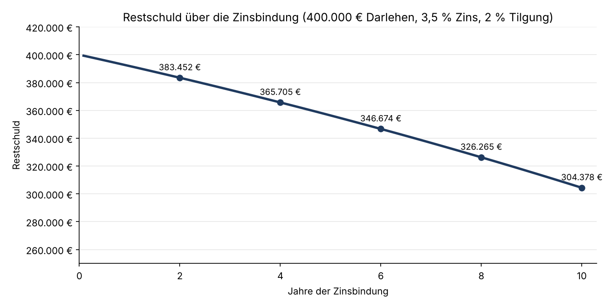

# Digitale Immobilienfinanzierung – End-to-End-Konzept mit Python-Prototypen

Konzept für eine digitale private Baufinanzierung bei einer deutschen Retailbank – von der Beratung bis zur Auszahlung – mit drei Python-Prototypen.

Projekt im Rahmen der Weiterbildung **„Python und Data Science im Finanzwesen“** an der IU Internationale Hochschule (Kurs: Projekt Banken und Versicherungen, 10/2026).

## Leitfrage

Wie kann eine deutsche Bank den Weg von der ersten Anfrage bis zur Auszahlung digitalisieren – schneller für Kunden und Bank, ohne Abstriche bei Risiko und Regulierung?

## Zielprozess in vier Phasen

1. **Beratung & Strukturierung** – Bedarfsermittlung, Finanzierungsstruktur
2. **Daten & Kreditprüfung** – digitale Kreditakte (Once-Only-Prinzip), Bonität und Kapitaldienstfähigkeit, Immobilienbewertung
3. **Entscheidung & Abschluss** – Kreditentscheidung mit menschlicher Freigabe, Vertrag mit qualifizierter elektronischer Signatur (QES)
4. **Sicherheiten & Auszahlung** – Notar, Grundschuld, Grundbuch, Auszahlungsvoraussetzungen

## Python-Prototypen (Notebook)

| Prototyp | Was er zeigt | Ergebnis im Beispiel |
|---|---|---|
| **Annuitätenrechner** | Rate, Zins- und Tilgungsanteil, Restschuld über die Zinsbindung | 400.000 € Darlehen, 3,5 % Zins, 2 % Tilgung: Rate 1.833,33 €, Restschuld nach 10 Jahren 304.378,33 € |
| **Regelbasiertes Routing** | Zuordnung der Anträge zu Fast-Track, Prüffall oder Risikofall | Testfälle A/B/C → Fast-Track / Prüffall / Risikofall |
| **Prozesskostenmodell** | Wirkung eines höheren Fast-Track-Anteils auf die Kosten je Antrag | 15–20 % Fast-Track → **−9 % bis −17 %** Prozesskosten je Antrag |



Alle Annahmen sind eigene, illustrative Setzungen – keine realen Bankdaten. Der Routing-Prototyp steuert den Bearbeitungsweg, nicht die Kreditentscheidung.

## Rechtlicher Rahmen

BGB §§ 505a/b (Kreditwürdigkeitsprüfung) · ImmoKWPLV · EGBGB Art. 247 (ESIS) · PSD2 · DSGVO Art. 22 · eIDAS · DORA · EBA-Leitlinien zur Kreditvergabe

## Empfehlung

**Risikoadäquate statt maximale Automatisierung:** Pilot für standardisierte Bestandsimmobilien-Finanzierungen, gemessen an vier KPIs (Durchlaufzeit, Fast-Track-Anteil, Prozesskosten je Antrag, Abbruchquote).

## Dateien

| Datei | Inhalt |
|---|---|
| `Digitale_Immobilienfinanzierung.ipynb` | Jupyter Notebook mit den drei Prototypen |
| `Praesentation_Digitale_Immobilienfinanzierung.pdf` | Projektpräsentation (25 Folien) |
| `restschuld.png` | Grafik: Restschuldverlauf (vom Notebook erzeugt) |
| `requirements.txt` | Benötigte Python-Pakete |

## Ausführen

```bash
pip install -r requirements.txt
jupyter notebook Digitale_Immobilienfinanzierung.ipynb
```

## Werkzeuge

Python · pandas · Matplotlib · Jupyter

---

**Ashraf Al Keilani** · Hannover · [LinkedIn](https://www.linkedin.com/in/ashraf-al-keilani)
